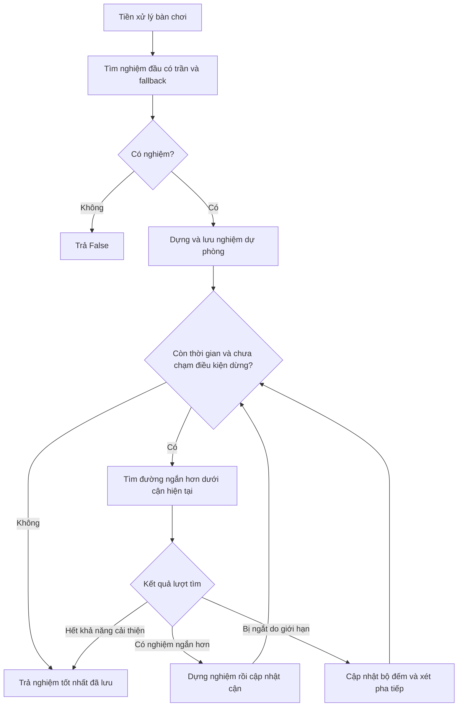

# Mô tả thiết kế solver Sokoban

Ban đầu, nhóm dùng Weighted A* với weight 4 và trả lời giải đầu tiên. Cách này giải được 20 map public nhưng chưa tận dụng thời gian còn lại để giảm số bước. Nhóm phát triển thành Anytime Weighted A*, giữ nghiệm dự phòng và tiếp tục tìm lời giải ngắn hơn và  bổ sung trần trạng thái, fallback và dừng cải thiện sớm
Mã nguồn được phát triển trong kho của nhóm. [GitHub](https://github.com/mitmit017/Sokoban-solver)

## 1. Thiết kế

### 1.1. Mục tiêu và giao diện

Hàm vào là `solve(initial_state, timebound=120)`. Mục tiêu là đưa mọi thùng lên đích, số đích có thể nhiều hơn số thùng. Mỗi lần một robot đi một ô tính một bước, bao gồm cả đi bộ và đẩy. `gval` lưu tổng chi phí của tất cả robot.

Nếu có nghiệm, hàm trả trạng thái đích `SokobanState` với chuỗi `parent`, `action` và `gval` hợp lệ. Khi chưa tìm được nghiệm trong các lần thử được cấp, hàm trả `False`. Kết quả này có thể xuất phát từ giới hạn tài nguyên và chưa chứng minh map vô nghiệm.

Solver dùng thư viện chuẩn Python và framework được cung cấp. Dữ liệu tiền xử lý và cache được tạo riêng cho mỗi lần gọi. Chương trình tuân theo luật sinh nước đi, giữ nguyên trạng thái đầu, xử lý tuần tự trong tiến trình được cấp và trả đầy đủ đường đi để bộ kiểm tra phát lại.

### 1.2. Quá trình lựa chọn phương pháp

| Thành phần | Thiết kế ban đầu | Bản hiện tại |
| --- | --- | --- |
| Tìm kiếm | Weighted A* với weight 4, dừng ở nghiệm đầu | Tìm nghiệm dự phòng rồi thử cải thiện |
| Heuristic | Ghép thùng chưa ở đích, cộng tiếp cận các thùng đó | Ghép toàn bộ thùng, cộng tiếp cận thùng gần robot nhất |
| Tiền xử lý | BFS ngược tính khoảng cách và một BFS riêng tính ô chết | Dùng cùng dữ liệu BFS cho khoảng cách và ô chết |
| Biểu diễn | Tạo trạng thái framework trong khi tìm, cả các bước đi bộ trung gian | Lưu node gọn và đoạn hành động, dựng chuỗi framework khi có nghiệm |
| Tài nguyên | Chưa có trần trạng thái cho lượt đầu | Trần 250k cho lượt đầu, 100k cho cải thiện, kèm điều kiện dừng sớm |

Weighted A* chọn node theo `f_w(s) = g(s) + w × h(s)`. Trọng số lớn tăng ưu tiên cho heuristic nhằm sớm tìm nghiệm. Sau đó, các trọng số nhỏ hơn được thử để cải thiện chi phí. Những lần thử khởi động lại từ trạng thái đầu, dùng nghiệm đang giữ làm cận trên.

Nhóm giữ nền tảng BFS ngược, Hungarian và phát hiện deadlock vì các thành phần này cung cấp thông tin đặc trưng của Sokoban. Việc tiếp tục cải thiện được thúc đẩy bởi kết quả public giảm từ 818 xuống 733 bước. Bản hiện tại bổ sung khả năng kiểm soát lượng công việc, với các đánh đổi được nêu ở mục 4.

### 1.3. Tổ chức chương trình và luồng hoạt động

| Hàm hoặc lớp | Trách nhiệm |
| --- | --- |
| `solve()`, `_solve()` | Giao diện và điều phối các giai đoạn |
| `_Board` | Láng giềng, khoảng cách đẩy, ô chết và cache |
| `_Node` | Vị trí robot, thùng, chi phí, cha và đoạn hành động |
| `_find_first()` | Tìm nghiệm đầu có trần và thử lại với weight lớn hơn |
| `_search()` | Heap ưu tiên, quản lý chi phí trạng thái và cắt nhánh |
| `_step_successors()`, `_push_successors()` | Sinh hành động đi từng bước hoặc theo lần đẩy |
| `_reconstruct()` | Dựng chuỗi trạng thái framework từ các node |

Luồng xử lý cho bàn chưa hoàn thành và ngân sách dương được tóm tắt dưới đây.



Ngân sách không dương dẫn đến `False`. Với ngân sách dương, bàn đã hoàn thành được trả ngay. Với bàn chưa giải, chương trình chỉ chuyển sang cải thiện sau khi đã dựng xong một đường đi hợp lệ. Khi công việc cải thiện bị ngắt, nghiệm hoàn chỉnh trước đó vẫn được giữ.

### 1.4. Heuristic và deadlock

**BFS ngược trong `_Board.__init__()`.** Từ mỗi đích, chương trình tính số lần đẩy tối thiểu trong mô hình chỉ xét tường và biên. Với ô đích của một bước đẩy là `q` và hướng `d`, bước ngược tới `q-d` chỉ hợp lệ khi cả `q-d` và ô robot hỗ trợ `q-2d` đều là ô sàn. Ô sàn không được tiếp cận từ bất kỳ đích nào được đánh dấu là ô chết tĩnh.

**Ghép thùng–đích trong `_Board.estimate()` và `_hungarian_min_cost()`.** Ma trận chi phí dùng khoảng cách đẩy tĩnh giữa mỗi thùng và mỗi đích. Hungarian tìm phép ghép có tổng nhỏ nhất, mỗi thùng gắn với một đích khác nhau. Toàn bộ thùng được xét, kể cả thùng đang ở đích, vì một số lời giải cần dịch chuyển các thùng này. Nếu có nhiều đích hơn thùng, thêm hàng giả chi phí 0. Với G đích, cách cài đặt ma trận vuông có thời gian `O(G³)`. Phép ghép chỉ phục vụ ước lượng, các hành động tìm kiếm vẫn tự quyết định đích cuối của từng thùng.

Heuristic còn cộng một cận dưới cho số bước đi bộ trước lần đẩy đầu tiên.

```text
approach = max(0, min Manhattan(robot, box) - 1)
h = matching_cost + approach
```

Phép lấy min xét mọi cặp robot–thùng. Khi tất cả thùng đã ở đích, trả `h=0`. Chi phí ghép bỏ qua vật cản động nên là cận dưới số lần đẩy. Phần tiếp cận bỏ qua đường vòng và vật cản nên là cận dưới số bước đi bộ trước lần đẩy đầu. Hai phần tính các loại bước khác nhau, tạo cơ sở dùng `h` để cắt nhánh.

**Kiểm tra bế tắc trong `_Board.deadlocked()` và `_is_frozen_deadlock()`.** Trạng thái bị loại nếu có thùng trên ô chết tĩnh hoặc có cụm đóng băng chứa thùng ngoài đích. Frozen bắt đầu với toàn bộ thùng trong tập ứng viên. Một trục bị khóa nếu một phía có tường, biên hoặc thùng còn trong tập. Một phía bị chắn đủ khóa cả hai hướng đẩy vì nó chiếm ô đến hoặc ô robot phải đứng.

Các thùng có ít nhất một trục chưa bị khóa được loại dần khỏi tập ứng viên cho đến khi ổn định. Trong tập còn lại, mỗi thùng đều bị chặn trên cả hai trục, nên không thùng nào có thể được đẩy đầu tiên. Nếu còn thùng ngoài đích, kết luận deadlock. Cụm nằm hoàn toàn trên đích được chấp nhận. Cách này cũng bao phủ các khối 2×2 đặc, vì vậy hàm kiểm tra 2×2 riêng đã được bỏ.

Chi phí ghép và deadlock được cache theo vị trí thùng, còn phần tiếp cận robot được tính lại. Mỗi cache xóa toàn bộ khi đạt 100k mục. Khi lượt tìm đầu chạm trần, `_find_first()` cũng xóa cache trước lần thử kế tiếp. Deadlock được kiểm tra ở gốc và sau nước đẩy, vì đi bộ giữ nguyên cấu hình thùng.

### 1.5. Không gian tìm kiếm và dựng lời giải

| Đặc điểm bàn | Tìm nghiệm đầu | Cải thiện |
| --- | --- | --- |
| Một robot | Push search | Push search |
| Nhiều robot, diện tích dưới 64 ô hoặc ít hơn 6 thùng | Step search | Step search |
| Nhiều robot, diện tích ít nhất 64 ô và ít nhất 6 thùng | Thử push trước trong tối đa 30 giây hoặc 25% thời gian tìm còn lại, rồi step nếu chưa có nghiệm | Step search |

Step search sinh một bước di chuyển của một robot. Push search dùng BFS tìm đường đi bộ ngắn nhất tới vị trí đứng đẩy, sau đó ghép với một lần đẩy. Một đoạn đi bộ 4 bước và đẩy 1 bước có chi phí 5. Trong BFS, chỉ các robot khác được coi là vật cản cố định, nên vị trí xuất phát của robot đang di chuyển có thể trở thành ô trống.

Map nhiều robot có thể cần nước đi bộ độc lập để nhường đường. Step search biểu diễn được hành động này, còn nhánh push chỉ sinh đoạn kết thúc bằng một lần đẩy. Vì vậy, phần cải thiện dùng step search cho mọi map nhiều robot.

Khóa trạng thái gồm vị trí robot đã sắp xếp và tập vị trí thùng. Cách sắp xếp gộp các cấu hình chỉ khác nhãn robot có cùng khả năng. Node vẫn giữ thứ tự robot thực tế để dựng đúng hành động. `best_cost` lưu chi phí nhỏ nhất đã biết. Đường rẻ hơn được đưa lại vào heap, bản ghi cũ bị bỏ khi lấy ra. Heap ưu tiên theo `(g+w*h, -g, serial)`.

`_Node` dùng `__slots__` và lưu đoạn hành động của cạnh. `_reconstruct()` truy ngược cha, đảo thứ tự đoạn rồi tạo từng `SokobanState`, mỗi bước tăng `gval` đúng 1. Chỉ sau khi dựng xong, nghiệm mới được thay vào `best_solution`. Hai cờ thử nghiệm `full_matching` và `single_robot_push` đã được bỏ, các lựa chọn mặc định được cố định như mô tả trên.

### 1.6. Giới hạn và điều kiện dừng

| Tham số | Giá trị và vai trò |
| --- | --- |
| Weight tìm đầu | `3 → 6 → 10`, tăng weight khi lượt trước chạm trần |
| Trần tìm đầu | 250.000 khóa `best_cost` cho mỗi lần `_search()` |
| Weight cải thiện | `2 → 1,4 → 1` |
| Trần cải thiện | 100.000 khóa `best_cost` mỗi lượt |
| Cửa sổ cải thiện | `min(20 giây, 25% timebound)`, đồng thời kết thúc trước deadline tìm chung |
| Mốc pha | 35%, 70%, 100% cửa sổ thực tế, tính cộng dồn |
| Dừng theo số lượt | Hai lượt liên tiếp bị ngắt do trần hoặc timeout mà chưa cập nhật nghiệm ở giữa |
| Dừng theo khoảng chờ | `min(8 giây, 10% timebound)` từ lúc bắt đầu cải thiện hoặc lần lưu nghiệm tốt hơn gần nhất |
| Dự phòng thời gian | `min(max(1 giây, 5% timebound), 20% timebound)` |

Deadline tổng là thời điểm bắt đầu cộng `timebound` rồi trừ `min(0,02 giây, 2% timebound)`. Deadline tìm chung sớm hơn deadline tổng một khoảng dự phòng. Với ngân sách 120 giây, dự phòng là 6 giây, cửa sổ cải thiện tối đa 20 giây và khoảng chờ là 8 giây.

Mỗi lần fallback trong cùng nhánh dùng chung deadline. `_find_first()` chỉ thử weight tiếp khi gặp `_SearchLimit`. Nếu lượt tìm trả `None` do đã cạn, hàm trả ngay. Khi cả ba weight đều chạm trần, hàm cũng trả `None`. Với map lớn nhiều robot, cả nhánh push và step có thể chạm trần ở tổng cộng sáu lần thử. Khi hết các lần được cấp mà chưa có nghiệm, `_solve()` trả `False` dù có thể còn thời gian.

Mỗi nghiệm tốt hơn đặt lại bộ đếm lượt bị ngắt và thời điểm cải thiện gần nhất. Cửa sổ cải thiện tổng vẫn giữ mốc kết thúc ban đầu. Deadline từng lượt là mốc sớm hơn giữa deadline pha và thời điểm hết khoảng chờ. Một số thao tác deadlock dùng deadline tìm chung, dựng đường đi dùng deadline tổng, nên việc hoàn tất thao tác và giải phóng bộ nhớ có thể vượt mốc pha.

## 2. Chất lượng lời giải

Nếu nghiệm đang giữ có cost C, chương trình chỉ cần tìm đường ngắn hơn C. `_search()` cắt nhánh khi `g+h >= C`. Weight chỉ ảnh hưởng thứ tự mở rộng. Cận cắt dùng heuristic gốc có cơ sở cận dưới đã trình bày ở mục 1.4.

Ví dụ, với C = 80, một node có g = 50 và h = 20 vẫn được xét vì g+h = 70, dù giá trị ưu tiên ở weight 3 là 110. Khi tìm và dựng xong nghiệm ngắn hơn, chương trình cập nhật cận rồi có thể tìm tiếp với cùng weight trong pha.

Ưu điểm của thiết kế là có nghiệm dự phòng, tính đầy đủ số bước và tận dụng một phần ngân sách để cải thiện. Đổi lại, các lượt khởi động lại có thể lặp công việc, còn trần và dừng sớm có thể bỏ lỡ nghiệm hoặc đường ngắn hơn. Lợi ích của các ngưỡng phải được đánh giá bằng thực nghiệm.

Nhóm chưa bảo đảm tối ưu cho mọi đầu vào. Nếu lượt cải thiện thực sự duyệt hết dưới cận và ghi `bounded_search_exhausted`, có thể xác nhận tối ưu khi heuristic là cận dưới, deadlock an toàn và sinh trạng thái đầy đủ. Cải thiện dùng step search cho nhiều robot và push search với đường đi bộ ngắn nhất cho một robot. Các lượt bị ngắt bởi giới hạn chưa đủ cơ sở kết luận tối ưu. Chạy đến weight 1 tự nó chưa đáp ứng điều kiện này.

## 3. Thực nghiệm

### 3.1. Thiết lập và kết quả public

Bộ public gồm 20 map, trong đó 18 map nhiều robot. Mỗi case chạy trong tiến trình mới, ngân sách 120 giây/map. Bộ kiểm thử giữ bản tham chiếu độc lập của đầu vào, phát lại từng hành động bằng `successors()`, kiểm tra đích, chi phí và đầu vào sau khi giải. PASS yêu cầu đường đi hợp lệ, đầu vào nguyên vẹn và `solve()` trả trong ngân sách.

Bảng tổng hợp số bước của bản ban đầu và bản hiện tại từ các lượt kiểm tra riêng trên cùng bộ public.

| Map | Robot | Kết quả ban đầu / hiện tại | Bước ban đầu | Bước hiện tại | Thời gian ban đầu (s) | Thời gian hiện tại (s) |
| --- | ---: | --- | ---: | ---: | ---: | ---: |
| 1 | 2 | PASS / PASS | 21 | 16 | 0,028 | 0,391 |
| 2 | 2 | PASS / PASS | 5 | 4 | 0,003 | 0,017 |
| 3 | 1 | PASS / PASS | 21 | 21 | 0,015 | 0,119 |
| 4 | 2 | PASS / PASS | 13 | 10 | 0,053 | 0,064 |
| 5 | 2 | PASS / PASS | 12 | 8 | 0,009 | 0,032 |
| 6 | 2 | PASS / PASS | 32 | 30 | 0,055 | 0,445 |
| 7 | 2 | PASS / PASS | 24 | 16 | 0,026 | 0,050 |
| 8 | 1 | PASS / PASS | 41 | 41 | 0,028 | 0,021 |
| 9 | 3 | PASS / PASS | 18 | 14 | 0,056 | 0,456 |
| 10 | 4 | PASS / PASS | 26 | 24 | 0,137 | 7,759 |
| 11 | 3 | PASS / PASS | 33 | 31 | 0,138 | 5,337 |
| 12 | 3 | PASS / PASS | 30 | 26 | 0,096 | 5,758 |
| 13 | 3 | PASS / PASS | 28 | 24 | 0,134 | 4,118 |
| 14 | 2 | PASS / PASS | 31 | 27 | 0,042 | 4,908 |
| 15 | 2 | PASS / PASS | 31 | 25 | 0,052 | 2,021 |
| 16 | 3 | PASS / PASS | 78 | 72 | 1,881 | 2,740 |
| 17 | 3 | PASS / PASS | 64 | 54 | 1,539 | 3,163 |
| 18 | 3 | PASS / PASS | 120 | 109 | 0,164 | 3,477 |
| 19 | 3 | PASS / PASS | 106 | 99 | 0,714 | 2,583 |
| 20 | 3 | PASS / PASS | 84 | 82 | 0,186 | 2,382 |

Cả hai bản đạt **20/20 PASS**. Tổng số bước giảm từ **818 xuống 733**, tức **85 bước, khoảng 10,4%**. Trung bình giảm từ **40,90 xuống 36,65 bước/map**. Bản hiện tại giữ kết quả public trong lượt đo đã thực hiện, còn khả năng giải test ẩn cần được kiểm tra thêm.

Lượt đo hiện tại có tổng thời gian solve khoảng **34,158 giây**, cộng từ log từng map đã làm tròn. Thời gian chịu ảnh hưởng của máy và tải hệ thống. Các lượt của bản cũ diễn ra ở thời điểm khác nên chưa dùng để xác định mức tăng tốc do riêng bounded.. Tổng số map được bounded xác nhận tối ưu chưa được thống kê trong lượt đo này.

### 3.2. Kiểm tra bổ sung và lựa chọn cấu hình

Bản hiện tại đạt **37/37 test**, gồm kiểm tra heuristic trên bàn nhỏ, frozen, lời giải dự phòng khi bị ngắt và benchmark public. Kiểm tra điều khiển xác nhận fallback đi qua các weight 3, 6, 10 dưới cùng deadline và các luật dừng giữ được nghiệm hợp lệ.

Một kiểm tra ép trần tìm đầu xuống 200 trạng thái trên map 18 cho thấy cả sáu lần push/step đều chạm trần. Solver trả `False` sau khoảng **0,0255 giây** với ngân sách 120 giây. Ca này xác nhận hạn chế hết lượt fallback dù còn thời gian. Đây là phép thử với ngưỡng giảm để kích hoạt nhánh xử lý, chưa xác định map nào gặp đủ sáu lần chạm trần ở mức 250k thực tế.

Nhóm từng thử tăng trần cải thiện lên 1M và phối hợp push/step trong các bản trước. Một số lượt cho cost tốt hơn nhưng thời gian và RAM tăng. Nhóm chọn bounded để kiểm soát lượng công việc, đồng thời vẫn giữ tổng 733 bước trên public. Hiệu quả giảm RAM trên map khó chưa được xác nhận bằng phép đo tương ứng của bản hiện tại.

## 4. Hạn chế và nguồn tham khảo

### 4.1. Hạn chế và hướng phát triển

| Hạn chế hiện tại | Hướng phát triển |
| --- | --- |
| Hết fallback có thể trả `False` dù còn thời gian | Phân biệt tìm cạn và bị ngắt do trần, thử chiến lược tiếp tục trong ngân sách còn lại |
| Trần trạng thái chưa giới hạn RAM theo byte, chưa xử lý `MemoryError` | Đo bộ nhớ đỉnh gồm heap, node cha và cache trước khi điều chỉnh ngưỡng |
| Dừng sớm có thể bỏ lỡ lời giải ngắn hơn | Đối chiếu cost với Anytime chạy lâu hơn trên map khó |
| Các lượt tìm khởi động lại, cache xóa toàn bộ khi đầy | Đánh giá tái sử dụng frontier và chính sách cache |
| Step search nhiều robot tăng nhanh, deadlock chưa đầy đủ | Nghiên cứu phối hợp tìm kiếm và mẫu deadlock có cơ sở, kèm test tránh loại nhầm |

Các mục này là hướng nghiên cứu tiếp theo. Ngưỡng hiện tại chưa bảo đảm tỷ lệ pass hoặc số bước tốt nhất trên mọi test ẩn.

### 4.2. Tài liệu, mã nguồn và AI

- Hansen và Zhou, *Anytime Heuristic Search*, JAIR 28 (2007), 267–297. Tham khảo ý tưởng có nghiệm sớm và tiếp tục cải thiện. Bản cài đặt của nhóm dùng các lượt khởi động lại và các giới hạn riêng. [Bài báo](https://arxiv.org/abs/1110.2737)
- Kuhn, *The Hungarian Method for the Assignment Problem* (1955). Tham khảo bài toán ghép có tổng chi phí nhỏ nhất, solver cài đặt bằng Python. [DOI](https://doi.org/10.1002/nav.3800020109)
- Tài liệu Python về heap ưu tiên. [heapq](https://docs.python.org/3/library/heapq.html)
- Các dự án khảo sát hướng giải Sokoban. Solver chạy bằng mã Python của nhóm và framework bài tập. [soukoban](https://docs.rs/soukoban/latest/soukoban/), [dangarfield/sokoban-solver](https://github.com/dangarfield/sokoban-solver)

Nhóm sử dụng **ChatGPT/Codex** để hỗ trợ phân tích, đề xuất và chỉnh mã, xây dựng kiểm thử, đối chiếu kết quả và biên tập báo cáo. Nhóm chịu trách nhiệm lựa chọn cấu hình, kiểm tra kết quả và giải thích thiết kế trong bài nộp.
