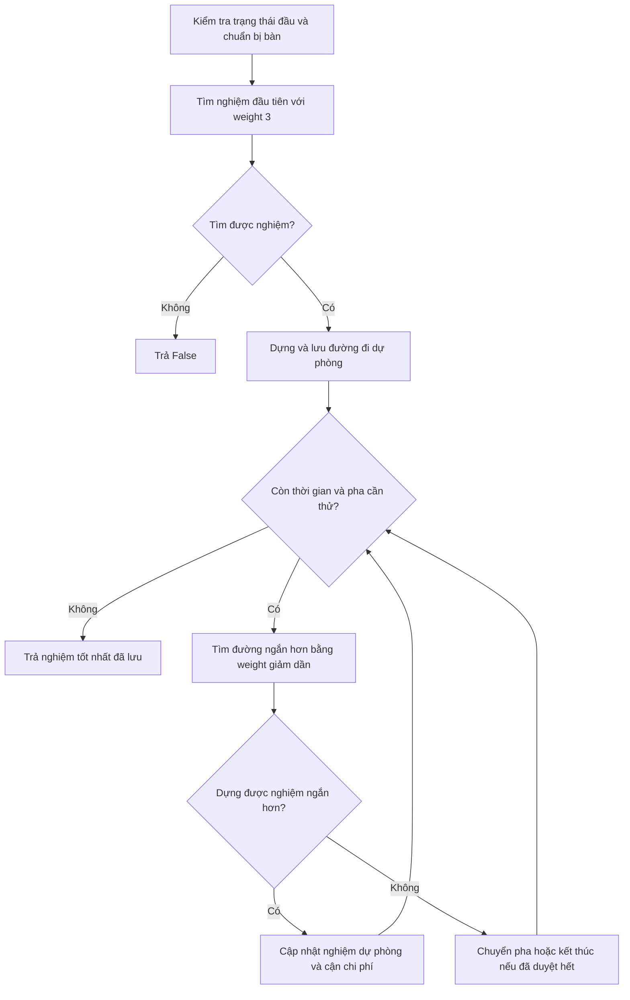

# Mô tả thiết kế solver Sokoban

Quá trình thiết kế của nhóm gồm hai giai đoạn. Ban đầu, nhóm xây dựng một bộ giải dùng Weighted A*, kết hợp heuristic và phát hiện deadlock để tìm được lời giải hợp lệ trong thời gian cho phép. Sau khi đã giải được các map public, nhóm nhận thấy chương trình dừng ngay ở nghiệm đầu tiên nên chưa tận dụng thời gian còn lại để giảm số bước. Từ đó, nhóm phát triển cách làm hiện tại: tìm một nghiệm sớm, giữ lại làm phương án dự phòng và tiếp tục tìm đường đi ngắn hơn trong ngân sách còn lại.

Mục tiêu của phiên bản cải tiến là đánh đổi thêm thời gian tính toán để giảm tổng số bước, đồng thời giữ lời giải hợp lệ đã tìm được. Nhóm không tuyên bố mọi lời giải đều ngắn nhất tuyệt đối.

## 1. Thiết kế

### 1.1. Bài toán và giao diện

**Đối chiếu mã nguồn (`solution.py`):** `solve(initial_state, timebound=120)` là hàm vào công khai.

Hàm vào của chương trình là `solve(initial_state, timebound=120)`. Mục tiêu là đưa **mọi thùng lên các ô đích**; số ô đích có thể lớn hơn số thùng. Mỗi lần một robot đi một ô đều tính một đơn vị chi phí, bao gồm đi bộ và đẩy thùng. Do đó, `gval` là tổng số bước của tất cả robot, không phải chỉ số lần đẩy.

Nếu có nghiệm, hàm trả về `SokobanState` ở đích với chuỗi `parent`, `action`, `gval` biểu diễn từng nước đi. Nếu chưa có nghiệm, hàm trả đúng `False`. Trả `False` vì hết ngân sách không đồng nghĩa với chứng minh map vô nghiệm.

Solver chỉ dùng `heapq`, `time`, `collections.deque` và framework được cung cấp. Nó không sửa luật chơi, không tạo tiến trình/luồng nền, không truy cập mạng, không lưu lời giải theo từng map và không dùng dữ liệu của test trước. Các bảng tiền xử lý và cache được tạo mới trong mỗi lần gọi `solve()`.

### 1.2. Từ thiết kế ban đầu đến phương pháp hiện tại

**Giai đoạn đầu: ưu tiên tìm được lời giải hợp lệ.** Nhóm tổ chức chương trình thành bốn phần: tiền xử lý bàn chơi, tính heuristic và kiểm tra deadlock, tìm kiếm, trả đường đi. Thuật toán tìm kiếm là Weighted A* với trọng số cố định **4** ở cả nhánh đi từng bước và nhánh tìm theo lần đẩy:

```text
f(s) = g(s) + 4 × h(s)
```

Cách làm của phiên bản ban đầu gồm:

| Thành phần | Cách thực hiện ban đầu |
| --- | --- |
| Tiền xử lý | BFS ngược từ các đích để tính khoảng cách đẩy; một BFS ngược đa nguồn riêng xác định các ô chết |
| Heuristic | Hungarian ghép các thùng **chưa ở đích** với các đích khác nhau; cộng ước lượng đi bộ tới một thùng chưa ở đích |
| Loại nhánh | Kiểm tra ô chết tĩnh, đóng băng và mẫu 2×2; bỏ đường đi không tốt hơn chi phí đã biết của cùng cấu hình |
| Chọn cách tìm | Với bàn từ 64 ô và ít nhất 6 thùng, thử push search trong tối đa 30 giây hoặc 25% thời gian còn lại; nếu chưa có nghiệm thì chuyển sang step search. Các bàn còn lại dùng step search ngay |
| Lưu trạng thái | Heap chứa trực tiếp các trạng thái framework; chuỗi cha và từng bước đi được tạo trong lúc sinh trạng thái, kể cả đoạn đi bộ trước khi đẩy |
| Điều kiện dừng | Khi lấy được trạng thái đích ra khỏi heap, trả ngay lời giải đó; chưa có bước tìm nghiệm ngắn hơn |

Luồng ban đầu có thể tóm tắt: **tiền xử lý → tìm bằng Weighted A* → gặp đích → trả lời giải đầu tiên**. Thiết kế này dễ đối chiếu với luật chơi, tính đủ số bước và tạo được nền tảng giải bài trước khi tập trung vào chất lượng đường đi.

**Kết quả và vấn đề nhận thấy.** Khi chạy lại hai phiên bản trên cùng 20 map public với ngân sách 120 giây/map, mỗi case trong tiến trình mới, thu được:

| Phiên bản | Map giải hợp lệ | Tổng số bước | Tổng thời gian solve |
| --- | ---: | ---: | ---: |
| Ban đầu: weight 4, dừng ở nghiệm đầu tiên | 20/20 | 818 | 3.544 giây |
| Cải tiến: tìm nghiệm rồi tiếp tục cải thiện | 20/20 | 733 | 57.636 giây |

Bảng kết quả từng map nằm ở mục 3.2. Phiên bản ban đầu giải nhanh và hợp lệ, nhưng việc dừng sớm không bảo đảm đường đi ngắn: chẳng hạn map 1 có 21 bước và map 17 có 64 bước, trong khi phiên bản cải tiến lần lượt đạt 16 và 54 bước. Điều này minh họa lý do nhóm chuyển trọng tâm từ “tìm được nghiệm” sang “tìm được nghiệm và dùng thời gian còn lại để cải thiện”.

**Giai đoạn cải tiến: giữ nền tảng, thay đổi cách tìm và sử dụng thời gian.** Nhóm giữ Weighted A*, BFS ngược, Hungarian và các kiểm tra deadlock, đồng thời điều chỉnh những điểm sau:

- Dùng weight 3 để tìm nghiệm đầu tiên, sau đó thử các weight nhỏ hơn thay vì trả kết quả ngay.
- Lưu node tìm kiếm gọn, chỉ dựng chuỗi trạng thái framework khi có một nghiệm cần giữ; cache heuristic và deadlock được dùng chung trong một lần giải.
- Ghép **toàn bộ thùng** với đích, kể cả thùng đã ở đích; tính chi phí tiếp cận trên tất cả thùng. Cách này phản ánh cả trường hợp phải dịch chuyển một thùng đang ở đích.
- Chọn push search cho một robot; giữ step search để mô hình hóa việc nhiều robot đi tránh đường. Sửa kiểm tra vị trí cũ của robot đang di chuyển trong nhánh đẩy.
- Dùng deadline chung, lưu nghiệm dự phòng và giới hạn từng lượt cải thiện để kiểm soát công việc bổ sung.

Trong lượt đối chiếu này, tổng số bước giảm **85 bước, khoảng 10,4%**, trong khi cả hai bản vẫn giải hợp lệ 20/20 map. Đây là kết quả của **toàn bộ thay đổi thiết kế**, không phải phép đo riêng tác dụng của Anytime hoặc riêng việc đổi trọng số. Thời gian tăng là sự đánh đổi nhóm chấp nhận để cải thiện cost trong ngân sách cho phép.

**Phương pháp của phiên bản hiện tại.**

Weighted A* chọn trạng thái chờ mở rộng theo:

```text
f_w(s) = g(s) + w × h(s)
```

Trong đó `g(s)` là số bước đã thực hiện; `h(s)` ước lượng chi phí còn lại. Trọng số đầu tiên `w = 3` tăng ưu tiên cho các trạng thái có heuristic nhỏ, nhằm sớm có lời giải. Sau đó, chương trình thử các trọng số `2.0`, `1.4`, `1.0` để tìm đường đi ngắn hơn dưới cận của nghiệm đã có.

Ý tưởng tìm một nghiệm sớm rồi tiếp tục cải thiện liên quan đến hướng nghiên cứu anytime heuristic search; bản cài đặt của nhóm không kế thừa mặc nhiên mọi bảo đảm lý thuyết của các thuật toán trong tài liệu. Xem [Hansen và Zhou, *Anytime Heuristic Search*](https://arxiv.org/abs/1110.2737).

Nhóm kết hợp hai cách sinh trạng thái:

| Cách tìm | Một cạnh tìm kiếm | Lý do sử dụng |
| --- | --- | --- |
| **Step search** | Một robot đi một ô, có thể kèm đẩy một thùng | Biểu diễn được việc robot đi tránh đường cho robot khác |
| **Push search** | Đường đi bộ ngắn nhất tới vị trí đứng đẩy, sau đó đẩy một thùng | Giảm các trạng thái chỉ khác nhau ở những bước đi bộ trung gian |

Push search dùng BFS cho từng robot, coi tường, thùng và robot khác là vật cản. Nó tính đủ chi phí đi bộ cộng một lần đẩy. Vị trí cũ của chính robot đang xét không bị coi là vật cản cố định. Khi có nhiều robot, chỉ sinh các đoạn kết thúc bằng một lần đẩy có thể bỏ qua việc một robot đi bộ để nhường đường; vì vậy step search vẫn cần thiết.

### 1.3. Luồng hoạt động của phiên bản hiện tại

**Đối chiếu mã nguồn (`solution.py`):** `solve()` gọi `_solve()` để điều phối tiền xử lý, tìm nghiệm đầu tiên và cải thiện nghiệm.

Có thể hiểu chương trình theo hai việc nối tiếp: **tìm một lời giải làm phương án dự phòng**, rồi **tìm lời giải tốt hơn nếu còn điều kiện**.

**Bước 1 — Chuẩn bị dữ liệu bàn chơi.** Kiểm tra ngân sách và trạng thái đầu. Nếu ngân sách không dương thì trả `False`; nếu bàn đã giải xong và còn ngân sách thì trả trạng thái đầu. Với bàn chưa giải, chương trình tính các ô có thể đi, khoảng cách đẩy tới đích và các ô chết. Các dữ liệu này được dùng lại trong quá trình tìm kiếm.

**Bước 2 — Tìm lời giải đầu tiên.** Chạy Weighted A* với weight 3. Với một robot, chương trình tìm theo các lần đẩy, nhưng vẫn tính đủ đường đi bộ trước mỗi lần đẩy. Với nhiều robot, chương trình dùng tìm từng bước; riêng bàn lớn, nhiều thùng được thử tìm theo lần đẩy trước, rồi chuyển sang tìm từng bước nếu chưa có nghiệm. Nếu kết thúc lượt tìm mà vẫn chưa có nghiệm, trả `False`.

Việc chọn nhánh tìm nghiệm đầu tiên được quy định cụ thể như sau:

| Đặc điểm bàn chơi | Nhánh tìm kiếm | Khi chưa tìm được nghiệm |
| --- | --- | --- |
| Một robot | Push search trong phần ngân sách dành cho tìm nghiệm đầu | Trả `False` khi kết thúc tìm mà chưa có nghiệm |
| Nhiều robot, diện tích dưới 64 ô hoặc ít hơn 6 thùng | Step search ngay từ đầu | Trả `False` khi kết thúc tìm mà chưa có nghiệm |
| Nhiều robot, diện tích ít nhất 64 ô và ít nhất 6 thùng | Thử push search trước, tối đa 30 giây hoặc 25% thời gian tìm còn lại, lấy mức nhỏ hơn | Chuyển sang step search với thời gian còn lại |

Ví dụ, một robot có thể đi bộ 4 bước rồi đẩy thùng 1 bước. Step search biểu diễn đoạn này bằng 5 cạnh; push search biểu diễn bằng 1 cạnh có chi phí **5**, không phải 1. Hai cách tìm chỉ khác độ gộp hành động, không thay đổi cách chấm số bước. BFS trong push search chỉ tối ưu đoạn đi bộ tới vị trí đứng đẩy ở cấu hình đang xét, không chứng minh toàn bộ lời giải Sokoban là ngắn nhất.

Với nhiều robot, một robot có thể phải đi sang ô khác để nhường đường dù bản thân chưa đẩy thùng. Step search sinh được nước đi đó; nhánh push hiện tại chỉ sinh các đoạn kết thúc bằng một lần đẩy nên có thể bỏ qua. Đây là lý do phần cải thiện của bài nộp dùng **step search cho mọi map Multi-Robot**, kể cả khi nghiệm đầu tiên được tìm bằng push search.

**Bước 3 — Giữ một lời giải hoàn chỉnh.** Khi tìm được đích, chương trình dựng đầy đủ từng hành động từ đầu tới đích và lưu lại. Từ thời điểm này, nếu công việc cải thiện bị ngắt do hết thời gian hoặc giới hạn trạng thái, chương trình vẫn có lời giải dự phòng để trả về.

**Bước 4 — Tìm cách giảm số bước.** Nếu còn thời gian, lần lượt thử weight `2.0 → 1.4 → 1.0`. Chi phí của nghiệm đang giữ làm cận trên: nhánh nào có `g + h` không nhỏ hơn cận này thì bỏ qua, vì không thể đem lại nghiệm ngắn hơn theo cận dưới đang dùng. Chỉ khi dựng xong một lời giải ít bước hơn, chương trình mới thay nghiệm dự phòng bằng lời giải mới. Sau đó có thể tiếp tục tìm với cận chặt hơn.

**Bước 5 — Trả nghiệm tốt nhất đã giữ được.** Dừng công việc cải thiện khi hết ngân sách, hết các pha cần thử hoặc lượt tìm đã duyệt hết những trạng thái còn có thể cải thiện. Kết quả trả về là đường đi tốt nhất đã dựng xong, không nhất thiết là nghiệm cuối cùng vừa bắt đầu tìm và cũng không được mặc nhiên coi là nghiệm tối ưu toàn cục.



Sơ đồ mô tả nhánh bàn chưa giải và ngân sách dương. Ví dụ, nếu nghiệm đầu có 80 bước và một lượt cải thiện tìm được đường 75 bước, chương trình giữ đường 75 bước. Nếu lượt tiếp theo hết thời gian mà chưa có kết quả tốt hơn, chương trình trả đường 75 bước, không quay lại đường 80 bước và không trả `False` chỉ vì lượt cải thiện bị ngắt. Đây là ví dụ minh họa cơ chế, không phải số đo của một map cụ thể.

Các giới hạn về thời gian, số trạng thái và cách chuyển pha được trình bày ở mục 1.6. Những giới hạn này quyết định khi nào chương trình tiếp tục cải thiện và khi nào phải trả nghiệm đang giữ.

### 1.4. Tiền xử lý, heuristic và loại trạng thái bế tắc

#### 1.4.1. Chuẩn bị phần cố định của bàn chơi

** `_Board.__init__()` — đoạn xây dựng bảng láng giềng `self.neighbors`.

`_Board` lưu chiều rộng, chiều cao, tường và các ô đích. Với mỗi ô không phải tường, chương trình tính trước bốn ô láng giềng theo thứ tự lên, phải, xuống, trái. Nếu một hướng ra ngoài bàn hoặc gặp tường, láng giềng tương ứng được ghi là không hợp lệ. Nhờ đó, lúc mở rộng trạng thái không cần tính lại biên bàn và tường cho cùng một ô.

Phần này chỉ mô tả yếu tố **cố định**. Thùng và robot thay đổi theo trạng thái nên được kiểm tra riêng khi sinh hành động. Một ô có trong bảng láng giềng chưa chắc đang đi được, vì nó có thể bị thùng hoặc robot khác chiếm.

#### 1.4.2. BFS ngược và khoảng cách đẩy tĩnh

** `_Board.__init__()` — đoạn BFS từ từng đích để tạo `self.push_distances`, sau đó tính `self.dead_cells`.

Từ từng ô đích, chương trình chạy BFS ngược để biết một thùng ở mỗi ô cần ít nhất bao nhiêu lần đẩy tới đích trong bàn chỉ xét tường và biên. Giả sử ô đang xét là `q`, một hướng đẩy là `d`; bước ngược từ `q` về `q-d` chỉ được chấp nhận nếu cả ô thùng trước đó `q-d` và ô robot phải đứng `q-2d` đều nằm trong bàn và không có tường.

Điều kiện về ô đứng của robot giúp khoảng cách này phản ánh khả năng đẩy tốt hơn khoảng cách Manhattan đơn thuần. Tuy nhiên, BFS ngược bỏ qua các thùng khác và khả năng robot thực sự đi tới ô hỗ trợ trong cấu hình hiện tại. Vì vậy, khoảng cách là một phép nới lỏng để hướng dẫn tìm kiếm, không phải đường đi đẩy chắc chắn thực hiện được.

Kết quả được lưu theo từng đích để lập ma trận ghép ở bước sau. Hợp của các ô được BFS từ ít nhất một đích tiếp cận cho biết nơi thùng còn có khả năng tới đích trong mô hình tĩnh. Ô sàn nằm ngoài hợp này được đánh dấu **ô chết**. Phiên bản hiện tại tái sử dụng cùng dữ liệu BFS cho cả khoảng cách đẩy và ô chết, không chạy thêm một BFS riêng chỉ để tính ô chết.

#### 1.4.3. Ghép toàn bộ thùng với các đích khác nhau

** `_Board.estimate()` lập ma trận chi phí; `_hungarian_min_cost()` tìm phép ghép có tổng chi phí nhỏ nhất.

Nếu mỗi thùng chỉ chọn đích gần nhất độc lập, nhiều thùng có thể cùng chọn một đích, khiến ước lượng không phản ánh yêu cầu mỗi đích chỉ chứa một thùng. Chương trình lập ma trận `C[i][j]`, trong đó mỗi phần tử là khoảng cách đẩy tĩnh từ thùng `i` đến đích `j`. Không có đường đẩy tĩnh thì chi phí của cặp đó là vô cực.

Thuật toán Hungarian tìm phép ghép có tổng chi phí nhỏ nhất, bảo đảm các thùng được ghép với các đích khác nhau. Ví dụ minh họa một ma trận chi phí, không phải số đo của map cụ thể:

| | Đích A | Đích B |
| --- | ---: | ---: |
| Thùng 1 | 1 | 2 |
| Thùng 2 | 1 | 5 |

Nếu gán thùng 1 tới A trước, thùng 2 còn B và tổng là `1 + 5 = 6`. Ghép thùng 1 tới B, thùng 2 tới A cho tổng `2 + 1 = 3`. Hungarian chọn phép ghép theo tổng chi phí thay vì lựa chọn tham lam riêng từng thùng. Đích được ghép chỉ phục vụ **ước lượng**, không ép các hành động tìm kiếm phải luôn đưa thùng đó đến đúng đích đã ghép.

Ma trận xét **toàn bộ thùng**, kể cả thùng đang ở đích. Khi số đích lớn hơn số thùng, thêm hàng giả có chi phí 0 để tạo ma trận vuông. Với `G` đích, phần Hungarian trong cách cài đặt này có độ phức tạp `O(G³)`. Nếu không tìm được phép ghép hữu hạn, heuristic trả vô cực và trạng thái không được đưa vào frontier. Tài liệu nền tảng về bài toán ghép được dẫn ở mục 4.2.

#### 1.4.4. Bổ sung chi phí robot tiếp cận thùng

 `_Board.estimate()` — đoạn tính `approach` và cộng phần tiếp cận vào chi phí ghép.

Tổng chi phí ghép mới ước lượng số lần đẩy. Trước lần đẩy đầu tiên, robot còn phải đi tới ô đứng cạnh thùng. Chương trình bổ sung:

```text
approach(s) = max(0, min khoảng cách Manhattan từ robot tới thùng - 1)
h(s) = matching_cost(s) + approach(s)
```

Phép lấy min xét tất cả cặp robot–thùng. Ví dụ, nếu khoảng cách nhỏ nhất là 4 thì phần tiếp cận bằng 3; nếu đã có robot đứng cạnh thùng thì phần này bằng 0. Đây chỉ là cận dưới vì chưa xét đường vòng hoặc vật cản. Khi mọi thùng đã ở đích, hàm trả `h=0` ngay.

Thành phần tiếp cận xét cả thùng đã ở đích, vì có tình huống phải đẩy một thùng đang ở đích ra ngoài để mở đường. Bỏ các thùng này có thể làm mất cơ sở dùng phần tiếp cận làm cận dưới cho những bước đi bộ trước lần đẩy đầu tiên.

#### 1.4.5. Deadlock và cache

** `_Board.deadlocked()`, `_is_frozen_deadlock()` và `_is_2x2_deadlock()` kiểm tra bế tắc; `_Board.estimate()` quản lý cache chi phí ghép.

Một trạng thái có thể còn nhiều nước đi cho robot nhưng các thùng đã ở cấu hình không thể hoàn thành. Nếu tiếp tục mở rộng trạng thái đó, tìm kiếm sẽ tốn tài nguyên mà không thu được nghiệm. `_Board.deadlocked()` kiểm tra ba nhóm:

| Kiểm tra | Cách thực hiện | Tác dụng |
| --- | --- | --- |
| Ô chết tĩnh | Kiểm tra có thùng nằm trong tập ô chết từ BFS ngược hay không | Loại sớm các ô không thể đưa thùng tới đích ngay cả khi bỏ qua vật cản động |
| Đóng băng theo cụm | Dùng vòng lặp loại dần các thùng có ít nhất một trục chưa bị khóa khỏi tập ứng viên đóng băng | Phát hiện thùng hoặc cụm thùng khóa nhau trên cả hai trục, bao gồm một số cấu hình zigzag |
| Khối 2×2 | Kiểm tra bốn ô đều là thùng, tường hoặc biên, có ít nhất một thùng chưa ở đích | Loại một số cấu hình bị kẹt thành khối |

Trong `_is_frozen_deadlock()`, ban đầu toàn bộ thùng được đưa vào tập ứng viên `frozen`. Với mỗi thùng, một trục được xem là bị khóa nếu ít nhất một phía có tường, biên bàn hoặc một thùng còn trong tập ứng viên. Một vật cản cố định ở một phía đủ chặn cả hai hướng đẩy trên trục đó: nó chiếm ô đến của thùng hoặc ô robot phải đứng để đẩy.

Các thùng có ít nhất một trục chưa bị khóa được gom vào `removable`, rồi loại khỏi tập ứng viên sau mỗi lượt quét. Chương trình xét lại tập còn lại cho đến khi tập rỗng hoặc không còn thay đổi. Việc loại một thùng khỏi tập ứng viên chỉ có nghĩa là chưa chứng minh được nó đóng băng, không khẳng định robot thực sự đẩy được nó.

Khi tập không còn thay đổi, không thùng nào trong tập có thể được đẩy đầu tiên: mỗi thùng đều bị tường hoặc các thùng cùng tập chặn trên cả hai trục. Nếu tập còn ít nhất một thùng chưa ở đích, hàm kết luận deadlock. Thùng đã ở đích vẫn tham gia làm vật cản, nhưng một cụm đóng băng nằm hoàn toàn trên đích không bị coi là deadlock. Bản hiện tại dùng vòng lặp, không còn đệ quy đánh dấu tạm; phương pháp vẫn chưa phát hiện đầy đủ mọi dạng bế tắc của Sokoban.

Deadlock được kiểm tra ở trạng thái đầu của mỗi lượt tìm và khi sinh một nước đẩy làm đổi cấu hình thùng. Nước đi bộ không làm thay đổi cấu hình thùng nên không cần tính lại deadlock chỉ vì robot đổi vị trí.

`_Board` có hai cache theo tập vị trí thùng: tổng chi phí ghép và kết quả deadlock. Nếu chỉ robot di chuyển, chi phí ghép có thể lấy lại từ cache; phần tiếp cận robot vẫn được tính lại. Cache được dùng chung giữa các lượt tìm trong một lần gọi solver, còn heap và bảng chi phí trạng thái được tạo mới mỗi lượt. Khi mỗi cache đạt 100.000 mục, chương trình xóa cache trước khi ghi mục mới. Cách làm này đơn giản nhưng có thể gây tính lại dữ liệu; nó không phải giới hạn bộ nhớ cho toàn bộ chương trình.

### 1.5. Biểu diễn trạng thái và vận hành một lượt tìm kiếm

#### 1.5.1. Tách dữ liệu bàn khỏi node tìm kiếm

** `_Node.__init__()` lưu dữ liệu node; `_Board.__init__()` lưu dữ liệu bàn dùng chung.

Tường và đích không đổi trong suốt một map, nên được giữ trong `_Board` để các node cùng sử dụng. Mỗi `_Node` chỉ lưu phần phục vụ tìm đường:

| Trường | Nội dung và vai trò |
| --- | --- |
| `robots` | Tuple vị trí robot, giữ đúng thứ tự chỉ số để dựng hành động |
| `boxes` | Tập bất biến các vị trí thùng, dùng trong kiểm tra ô bị chiếm và tạo khóa |
| `cost` | Số bước đi bộ và đẩy đã thực hiện từ đầu |
| `parent` | Node cha, dùng để truy ngược khi đã tìm được nghiệm |
| `actions` | Đoạn hành động nối node cha với node hiện tại, gồm chỉ số robot và hướng di chuyển |

Node dùng `__slots__` để giảm phần phụ trội của đối tượng Python. Khi step search sinh một cạnh, `actions` có một hành động. Khi push search sinh một cạnh, nó chứa đường đi bộ đã tìm bằng BFS và lần đẩy cuối. Chi phí mới luôn bằng `cost` của node cha cộng **độ dài đoạn hành động**.

Nhờ lưu các đoạn này, chương trình không cần tạo chuỗi `SokobanState` đầy đủ cho mọi đoạn đi bộ đang thử. Nó vẫn giữ node cha và hành động, nên đây là cách giảm chi phí biểu diễn, không phải loại bỏ toàn bộ bộ nhớ lưu đường đi.

#### 1.5.2. Nhận biết trạng thái trùng và tránh làm lại đường đắt hơn

** `_search()` — đoạn tạo khóa trạng thái, cập nhật `best_cost` và bỏ bản ghi lỗi thời trong heap.

Khóa tìm kiếm có dạng:

```text
(tuple các vị trí robot đã sắp xếp, tập vị trí thùng)
```

Sắp xếp robot giúp gộp các cấu hình chỉ khác nhãn của những robot có cùng khả năng. Tuy nhiên, node vẫn giữ tuple robot theo đúng chỉ số thực tế; chuỗi hành động được dựng theo node, không theo tuple đã sắp xếp. Vị trí chính xác của robot vẫn nằm trong khóa, không chỉ lưu vùng robot có thể đi tới, vì các vị trí khác nhau có thể dẫn đến số bước đi bộ khác nhau.

Dictionary `best_cost` ghi chi phí thấp nhất đã biết tới mỗi khóa trong lượt tìm hiện tại. Nếu đã có đường tới cùng cấu hình với chi phí không lớn hơn, bỏ đường mới. Nếu đường mới rẻ hơn, cập nhật bảng và đưa node vào heap. Node cũ có thể vẫn nằm trong heap; khi được lấy ra, nó bị bỏ qua nếu chi phí lớn hơn giá trị tốt nhất hiện có. Do đó, chương trình có thể mở lại một trạng thái khi phát hiện đường rẻ hơn, thay vì coi mọi trạng thái từng gặp là đã xử lý xong vĩnh viễn.

#### 1.5.3. Thứ tự mở rộng và các bước trong `_search()`

** `_search()` quản lý heap và cắt nhánh; `_step_successors()` và `_push_successors()` sinh trạng thái kế tiếp.

Frontier là heap chứa những node đang chờ mở rộng, sắp theo `(g + w*h, -g, serial)`. Thành phần thứ nhất ưu tiên node có tổng chi phí đánh giá nhỏ; khi bằng nhau, `-g` ưu tiên node đã đi sâu hơn theo chi phí. `serial` là bộ đếm để Python không phải so sánh trực tiếp hai đối tượng node.

Một lượt tìm có trình tự:

1. Tạo node đầu, kiểm tra deadlock và tính heuristic. Nếu bị loại hoặc không thể cải thiện cận đang có, kết thúc lượt tìm mà không trả node nghiệm.
2. Đưa node đầu vào heap và ghi chi phí ban đầu vào `best_cost`.
3. Kiểm tra deadline, lấy node ưu tiên nhất ra khỏi heap, bỏ qua bản ghi lỗi thời nếu có.
4. Nếu mọi thùng ở đích, trả node này về bộ điều phối. Một lượt `_search()` dừng ở nghiệm đầu tiên của lượt đó; **bộ điều phối bên ngoài** chịu trách nhiệm tìm tiếp.
5. Sinh các cạnh hợp lệ bằng step search hoặc push search. Loại nước đi ra ngoài bàn, vào tường, vào robot khác, đẩy vào ô bị chiếm hoặc gây deadlock theo các kiểm tra đã cài đặt.
6. Với mỗi node con, tính chi phí mới; bỏ đường không tốt hơn đường đã biết. Tính heuristic, loại heuristic vô cực hoặc nhánh có `g+h` không nhỏ hơn cận nghiệm.
7. Nếu còn trong giới hạn trạng thái, cập nhật `best_cost` và đưa node con vào heap. Lặp lại cho tới khi có nghiệm, hết heap hoặc bị ngắt bởi giới hạn.

Khi chưa có nghiệm dự phòng, cận chi phí là vô cực nên điều kiện cắt theo nghiệm tốt nhất chưa làm giảm các trạng thái hữu hạn. Trong giai đoạn cải thiện, cận chính là cost của nghiệm đang giữ và chỉ tìm những lời giải **ngắn hơn**, không tìm thêm lời giải cùng cost.

#### 1.5.4. Dựng lời giải đúng giao diện

** `_reconstruct()` truy ngược các node và dựng chuỗi `SokobanState` theo từng bước.

Khi tìm được node đích, `_reconstruct()` đi ngược theo `parent` để thu các đoạn hành động, đảo lại thứ tự rồi thực hiện từ trạng thái đầu. Mỗi hành động tạo một `SokobanState` mới, gán `parent` là trạng thái trước, `action` theo dạng chỉ số robot và hướng, đồng thời tăng `gval` đúng 1. Nhờ vậy, một cạnh push search gồm nhiều bước vẫn được trả thành đầy đủ từng bước cho bộ kiểm tra.

Trạng thái đầu chỉ được dùng làm điểm bắt đầu của chuỗi, không bị sửa vị trí robot, thùng hay chi phí. Thùng được cập nhật bằng một tập mới khi có đẩy. Nghiệm mới chỉ được gán thành nghiệm tốt nhất **sau khi dựng xong**; nếu quá trình dựng bị ngắt bởi deadline, nghiệm trước đó vẫn được giữ.

### 1.6. Điều phối Anytime và quản lý tài nguyên

#### 1.6.1. Hai giai đoạn có mục tiêu khác nhau

** `_solve()` — đoạn lưu `best_solution` sau nghiệm đầu và vòng lặp qua `_IMPROVEMENT_WEIGHTS`.

Giai đoạn đầu dùng weight 3 để ưu tiên sớm có đường đi hợp lệ. Sau khi dựng được đường đi này, biến `best_solution` giữ trạng thái đích của nghiệm dự phòng. Giai đoạn sau dùng các weight `2.0`, `1.4`, `1.0` để thử giảm cost. Đây là nhiều lượt Weighted A* khởi động lại, **không phải** giữ nguyên một heap rồi đổi weight.

Mỗi khi tìm được một nghiệm ngắn hơn, chương trình cập nhật `best_solution` và cận `C`. Nếu pha vẫn còn thời gian, nó có thể chạy lại với **cùng weight** nhưng cận chặt hơn. Vì vậy, một pha có thể cải thiện nhiều lần; không phải cứ tìm được một nghiệm là chuyển ngay sang weight tiếp theo. Các cache của `_Board` được giữ lại, nhưng `best_cost` và frontier của lượt trước không được tái sử dụng.

#### 1.6.2. Chia thời gian cho các pha

** `_solve()` — các biến `improvement_deadline`, `remaining` và `phase_deadline` xác định cửa sổ cải thiện.

Sau khi có nghiệm đầu, chương trình tính khoảng thời gian còn có thể dùng cho cải thiện. Ba pha có các mốc kết thúc cố định ở 35%, 70%, 100% khoảng thời gian này:

| Pha | Weight | Mốc kết thúc trong cửa sổ cải thiện |
| --- | ---: | ---: |
| 1 | 2.0 | 35% |
| 2 | 1.4 | 70% |
| 3 | 1.0 | 100% |

Đây là **các mốc cộng dồn**, không phải ba lần cấp mới toàn bộ thời gian. Nếu pha trước chạm giới hạn trạng thái và dừng sớm, pha sau có thể bắt đầu ngay và dùng thời gian tới mốc của nó. Nếu một lượt tìm đã duyệt hết các trạng thái dưới cận đang giữ, bộ điều phối trả nghiệm hiện có thay vì bắt buộc chạy đủ cả ba pha.

Giả sử còn 100 giây cho cải thiện, các mốc minh họa sẽ là giây thứ 35, 70 và 100 tính từ lúc bắt đầu giai đoạn này. Đây chỉ là ví dụ giải thích lịch pha, không phải ngân sách cố định cho mọi map.

#### 1.6.3. Phân biệt các kiểu kết thúc

** `_solve()` xử lý kết quả và ngoại lệ; `_check_time()` phát sinh `_Timeout`; `_search()` phát sinh `_SearchLimit` khi chạm trần trạng thái.

| Tình huống | Xử lý của bản hiện tại |
| --- | --- |
| Chưa có nghiệm, lượt tìm đầu kết thúc mà không trả được node đích | Trả `False` |
| Có nghiệm tốt hơn và dựng xong đường đi | Cập nhật nghiệm dự phòng, có thể tiếp tục cùng pha |
| Lượt cải thiện hết deadline pha | Giữ nghiệm hiện có, chuyển sang pha sau nếu còn điều kiện |
| Lượt cải thiện chạm trần trạng thái | Giữ nghiệm hiện có, bỏ phần còn lại của pha đó rồi xét pha sau |
| Lượt cải thiện hết heap hoặc cận ở gốc đã loại toàn bộ khả năng cải thiện | Trả nghiệm đang giữ |
| Đang dựng nghiệm tốt hơn thì gặp deadline | Không thay thế nghiệm cũ bằng đường đi chưa dựng xong |

Trần 100.000 áp dụng cho **số khóa trong `best_cost` của mỗi lượt cải thiện**, không phải số lần mở rộng, kích thước heap hay tổng RAM. Heap có thể chứa cả node cũ; node cha và cache cũng dùng bộ nhớ. Lượt tìm nghiệm đầu tiên chưa có trần trạng thái này, nên chưa thể xem solver là chương trình đã giới hạn cứng bộ nhớ.

Thời gian được đo bằng `time.perf_counter()` ở các bước tiền xử lý, tìm kiếm, tính heuristic và dựng đường đi. Với ngân sách 120 giây, deadline tổng là thời điểm bắt đầu cộng 120 giây trừ biên 0,02 giây. Deadline tìm nghiệm đầu sớm hơn deadline tổng 1 giây; deadline cải thiện sớm hơn deadline tổng 6 giây. Nếu phần cải thiện không còn thời gian, chương trình trả ngay nghiệm đã giữ.

Những khoảng chừa này nhằm giảm nguy cơ trả kết quả trễ do dựng đường đi và giải phóng dữ liệu. Chúng không ngăn được mọi tình huống trễ hoặc thiếu bộ nhớ. Solver không tạo tác vụ nền để tiếp tục tìm kiếm sau khi đã trả kết quả.

## 2. Chất lượng lời giải

### 2.1. Cải thiện và cắt nhánh

** `_search()` cắt nhánh theo `best_cost_bound`; `_solve()` cập nhật `best_solution` sau khi dựng xong nghiệm tốt hơn.

Giả sử nghiệm tốt nhất đang có chi phí `C`. Một trạng thái mới không có khả năng cải thiện khi:

```text
g(s) + h(s) >= C
```

Điều kiện này dùng **heuristic không nhân weight**. Chi phí ghép là cận dưới số lần đẩy do đã bỏ qua các cản trở động; phần Manhattan là cận dưới số bước đi bộ trước lần đẩy đầu tiên. Hai phần không đếm trùng bước đi bộ với bước đẩy. Đây là cơ sở sử dụng `h` làm cận dưới trong điều kiện cắt nhánh. Weight chỉ dùng để quyết định thứ tự mở rộng, không dùng làm cận dưới để loại trạng thái.

Ví dụ minh họa khi nghiệm đang giữ có `C = 80`:

| Trạng thái đang xét | `g + h` | Quyết định |
| --- | ---: | --- |
| `g = 50`, `h = 35` | 85 | Bỏ: ngay cả cận dưới cũng không tốt hơn 80 |
| `g = 50`, `h = 20` | 70 | Giữ để xét tiếp: còn khả năng cải thiện, nhưng chưa chắc thực sự có nghiệm dưới 80 |

Nếu dùng weight 3, trạng thái thứ hai có độ ưu tiên `g + 3h = 110`. Chương trình vẫn không loại nó chỉ vì 110 lớn hơn 80: **110 dùng để xếp thứ tự, còn 70 mới là cận dưới dùng để cắt nhánh**. Phân biệt hai vai trò này giúp tránh loại mất đường đi có thể tốt hơn nghiệm hiện tại.

Chương trình chỉ thay nghiệm dự phòng sau khi dựng xong một đường đi có cost nhỏ hơn. Ví dụ, trên public map 2, bản tìm nghiệm đầu với weight 3 cho lời giải 5 bước; bản Anytime trả lời giải 4 bước. BFS độc lập trên map nhỏ này xác nhận 4 là tối ưu **cho riêng trường hợp đó**.

### 2.2. Ưu điểm, nhược điểm và giới hạn tối ưu

**Ưu điểm:** có nghiệm sớm làm phương án dự phòng; tận dụng thời gian còn lại để giảm cost; đếm đủ bước đi bộ và đẩy; hỗ trợ một hoặc nhiều robot; tiền xử lý và cache giảm các phép tính lặp; giới hạn lượt cải thiện giúp kiểm soát phần công việc bổ sung.

**Nhược điểm:** tổng thời gian trả kết quả thường dài hơn việc dừng ngay ở nghiệm đầu; mỗi lượt khởi động lại nên có thể mở lại nhiều trạng thái; map nhiều robot làm step search tăng nhanh; trần trạng thái có thể dừng cải thiện dù còn thời gian; kiểm tra deadlock chưa đầy đủ và cấu trúc tìm kiếm có thể tốn RAM.

Nhóm **không tuyên bố solver luôn trả lời giải tối ưu** và không đưa ra hệ số bảo đảm so với tối ưu. Việc chạy tới weight 1 không đủ để kết luận tối ưu nếu lượt đó bị ngắt vì deadline hoặc giới hạn trạng thái. Những bảo đảm của A* còn đòi hỏi heuristic/cắt nhánh đúng, khả năng mở lại trạng thái và không gian sinh đầy đủ; push search nhiều robot không tự đáp ứng điều kiện cuối. Kiểm tra một số bàn nhỏ không thay thế chứng minh cho mọi bàn chơi.

Việc giữ nghiệm dự phòng bảo vệ kết quả trước các ngoại lệ thời gian/giới hạn tìm kiếm đã xử lý, nhưng không bảo đảm sống sót khi hệ điều hành dừng tiến trình vì thiếu bộ nhớ. `False` cũng có thể xuất hiện khi lượt đầu chưa kịp tìm hoặc dựng nghiệm.

## 3. Thực nghiệm

### 3.1. Thiết lập và tiêu chí kiểm tra

Trước khi gọi solver, bộ kiểm thử lưu một bản tham chiếu độc lập. Sau khi có kết quả, `validate_solution()` lần ngược chuỗi cha, kiểm tra điểm đầu, phát lại từng hành động bằng `successors()`, kiểm tra `gval` tăng đúng một bước và kiểm tra đích. Đồng thời kiểm tra đầu vào không bị sửa. Chỉ tính PASS khi lời giải hợp lệ và thời gian gọi `solve()` không vượt ngân sách.

Thời gian dưới đây chỉ đo `solve()`, không gồm khởi động Python và xác minh đường đi. Đây là **một lượt đo**, phụ thuộc máy và tải hệ thống, không phải trung vị nhiều lần chạy. Bộ kiểm thử có watchdog tiến trình riêng cho tình huống treo; watchdog này không được đồng nhất với thời gian solve hoặc với mọi chi tiết của bộ chấm chính thức.

### 3.2. Đối chiếu phiên bản ban đầu và phiên bản cải tiến trên 20 public map

**Phạm vi số liệu:** Bảng dưới giữ nguyên lượt đo trước khi sửa luật frozen. Sau khi bổ sung kiểm tra đóng băng theo cụm như mục 1.4.5, lượt kiểm tra lại vẫn đạt 20/20 map public với tổng 733 bước. Thời gian của bản mới không được thay vào bảng lịch sử; chưa kết luận thay đổi frozen làm solver nhanh hơn.

Lượt đối chiếu ngày 05/11/2026 dùng cùng bộ map, cùng ngân sách **120 giây/map**, chạy tuần tự mỗi map/phiên bản trong một tiến trình Python mới. Bảng ghi số bước và thời gian của đúng hai phiên bản được mô tả ở mục 1.2; không sử dụng số liệu của bản thử nghiệm tăng trần trạng thái.

| Map | Số robot | Kết quả ban đầu / cải tiến | Bước ban đầu | Bước cải tiến | Thời gian ban đầu (s) | Thời gian cải tiến (s) |
| --- | ---: | --- | ---: | ---: | ---: | ---: |
| 1 | 2 | PASS / PASS | 21 | 16 | 0.010 | 0.072 |
| 2 | 2 | PASS / PASS | 5 | 4 | 0.001 | 0.001 |
| 3 | 1 | PASS / PASS | 21 | 21 | 0.006 | 0.020 |
| 4 | 2 | PASS / PASS | 13 | 10 | 0.016 | 0.006 |
| 5 | 2 | PASS / PASS | 12 | 8 | 0.004 | 0.005 |
| 6 | 2 | PASS / PASS | 32 | 30 | 0.029 | 0.095 |
| 7 | 2 | PASS / PASS | 24 | 16 | 0.012 | 0.018 |
| 8 | 1 | PASS / PASS | 41 | 41 | 0.011 | 0.008 |
| 9 | 3 | PASS / PASS | 18 | 14 | 0.029 | 0.093 |
| 10 | 4 | PASS / PASS | 26 | 24 | 0.064 | 9.117 |
| 11 | 3 | PASS / PASS | 33 | 31 | 0.086 | 4.719 |
| 12 | 3 | PASS / PASS | 30 | 26 | 0.054 | 6.151 |
| 13 | 3 | PASS / PASS | 28 | 24 | 0.071 | 6.610 |
| 14 | 2 | PASS / PASS | 31 | 27 | 0.018 | 5.251 |
| 15 | 2 | PASS / PASS | 31 | 25 | 0.021 | 1.787 |
| 16 | 3 | PASS / PASS | 78 | 72 | 0.864 | 4.356 |
| 17 | 3 | PASS / PASS | 64 | 54 | 1.230 | 5.923 |
| 18 | 3 | PASS / PASS | 120 | 109 | 0.123 | 4.412 |
| 19 | 3 | PASS / PASS | 106 | 99 | 0.752 | 3.941 |
| 20 | 3 | PASS / PASS | 84 | 82 | 0.142 | 5.050 |

- Cả hai phiên bản giải hợp lệ **20/20 map**, gồm **18 map Multi-Robot**; không có crash, quá giờ hoặc thay đổi đầu vào trong lượt đo này.
- Tổng số bước giảm từ **818 xuống 733**, tức **85 bước (khoảng 10,4%)**. Trung bình giảm từ **40,90 xuống 36,65 bước/map**.
- Tổng thời gian solve tăng từ **3.544 lên 57.636 giây**; cộng từ số đo chưa làm tròn. Map cải tiến lâu nhất mất **9.117 giây**, dưới ngân sách 120 giây/map.
- Việc tìm được đường ngắn hơn chứng minh nghiệm ban đầu của những map đó chưa tối ưu; không chứng minh mọi nghiệm cải tiến đã tối ưu. Bảng phản ánh một lượt đo, không bảo đảm kết quả tương tự trên mọi test ẩn.

### 3.3. Thử nghiệm tối ưu và lý do chốt phiên bản

Nhóm đã thử các cấu hình ngoài bản chọn: nâng trần cải thiện lên 1M trạng thái và thêm push search trước step search trong các pha cải thiện Multi-Robot. Trong các lượt 30 giây/map đã lưu, bản 100k đạt 733 bước; bản 1M không hybrid đạt 729 bước; bản 1M có hybrid đạt 726 bước, đều giải đủ 20 public. Tuy nhiên, thời gian tổng tăng đáng kể và bộ nhớ đỉnh của các bản 1M cao hơn. Đây là những lượt đo riêng, không phải một bảo đảm rằng thứ tự tốt–xấu luôn giữ nguyên.

Trên public map 20 ở ngân sách 120 giây, bản 100k đạt 82 bước, khoảng 4,22 giây và 101 MiB Peak Working Set; bản thử nghiệm 1M không hybrid đạt 73 bước, khoảng 80,38 giây và 751 MiB. Một lượt 30 giây chạy riêng từng đạt 73 bước nhưng lượt đầy đủ chỉ đạt 82 bước: thời điểm cắt pha có thể làm thay đổi kết quả. Vì chưa rõ giới hạn RAM của máy chấm và lợi ích chưa đồng đều, nhóm giữ bản 100k làm phiên bản chính. Số liệu này không được trộn vào bảng kết quả bản chọn ở mục 3.2.
## 4. Hạn chế và nguồn tham khảo

### 4.1. Phần chưa hoàn thiện và hướng phát triển

| Hạn chế của bản chọn | Hướng cải thiện dự kiến |
| --- | --- |
| Các lượt tìm khởi động lại, chưa tái sử dụng frontier | Nghiên cứu tiếp tục tìm trên frontier cũ; xử lý đúng cận mới, độ ưu tiên và việc mở lại trạng thái |
| Trần 100k có thể dừng sớm; trần này không phải giới hạn RAM | Điều chỉnh tài nguyên theo số liệu đo và giới hạn máy chấm; chỉ nâng trần sau khi kiểm tra bộ nhớ |
| Lượt tìm nghiệm đầu chưa có trần trạng thái; thời gian dọn dữ liệu không cố định | Đánh giá cơ chế bảo vệ lượt đầu và dự phòng thời gian phù hợp hơn |
| Step search nhiều robot tăng nhanh; push search thiếu các hành động nhường đường độc lập | Thử phối hợp hai cách tìm với ngân sách phù hợp, không coi push search cạn frontier là chứng minh tối ưu |
| Deadlock chỉ bao phủ một số mẫu | Bổ sung mẫu có cơ sở và test tránh loại nhầm trạng thái có nghiệm |
| Cache xóa toàn bộ khi đủ 100k mục | Đo tỷ lệ cache hit trước khi thử chính sách thay thế khác |
| Kiểm tra deadline thường xuyên và vòng lặp xác định cụm đóng băng có chi phí | Chỉ giảm overhead sau khi đo; giữ kiểm tra thời gian trong các thao tác có thể kéo dài |

Những mục này là hướng phát triển, không phải tính năng đã có trong phiên bản nộp.

### 4.2. Tài liệu và mã nguồn tham khảo

1. **Anytime heuristic search:** Eric A. Hansen và Rong Zhou, *Anytime Heuristic Search*, JAIR 28 (2007), 267–297; [bản tác giả trên arXiv](https://arxiv.org/abs/1110.2737). Dùng để đối chiếu ý tưởng có nghiệm sớm và tiếp tục cải thiện, không coi cách cài đặt khởi động lại của nhóm là bản sao có đầy đủ bảo đảm của thuật toán trong bài báo.
2. **Bài toán ghép thùng–đích:** Harold W. Kuhn, *The Hungarian Method for the Assignment Problem*, Naval Research Logistics Quarterly 2 (1955), 83–97, [DOI: 10.1002/nav.3800020109](https://doi.org/10.1002/nav.3800020109). Mã Python trong solver tự thực hiện phép ghép, không phụ thuộc thư viện Hungarian bên ngoài.
3. **Thư viện chuẩn Python:** [tài liệu `heapq`](https://docs.python.org/3/library/heapq.html), dùng cho hàng đợi ưu tiên. Các cấu trúc và API khác sử dụng trực tiếp thư viện chuẩn theo quy định.
4. **Các dự án được đưa ra để khảo sát hướng giải Sokoban:** [soukoban](https://docs.rs/soukoban/latest/soukoban/), [dangarfield/sokoban-solver](https://github.com/dangarfield/sokoban-solver). Đây là nguồn tham khảo mở rộng; bản chọn không import hoặc gọi các dự án này khi chạy. Không tuyên bố toàn bộ kỹ thuật của chúng đã được tích hợp.

Phiên bản chọn được phát triển từ các bản solver Python trong workspace của nhóm.

### 4.3. Công cụ AI đã sử dụng

Nhóm sử dụng **ChatGPT/Codex** để hỗ trợ đọc và đánh giá mã, đề xuất thiết kế, viết/chỉnh sửa các phần mã và bản thử nghiệm.
